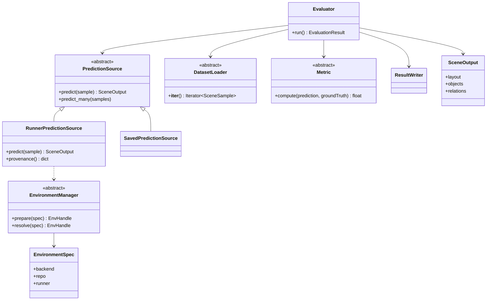
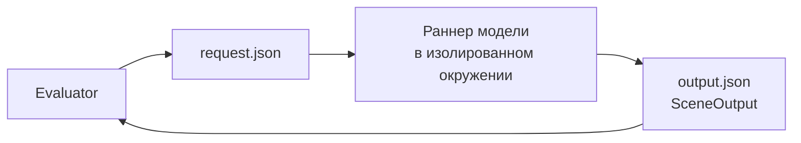

# Устройство и запуск

Как устроен комплекс, как его запускать и как подключить свою модель. Смысл показателей —
в [metrics.md](metrics.md), воспроизведение статьи — в [igibson.md](igibson.md)
и [front3d.md](front3d.md).

Устройство следует из одного требования: несколько методов, каждому из которых нужен
свой несовместимый стек, должны считаться одним и тем же кодом и оставлять достаточно
следов, чтобы прогон можно было повторить. Комплекс подключает и оценивает модели, но не
хранит их код, веса и наборы данных.

## Быстрый старт

Без GPU, сети и модели:

```bash
make setup
make smoke        # показатели по готовому предсказанию
make env-demo     # env prepare echo + run echo_local: весь путь через изолированное окружение
cat artifacts/echo/report.md
```

Настоящий метод запускается так же, только окружение тяжелее: `env prepare` один раз на
модель, затем `run` на каждый эксперимент. `pano3dbench env doctor` показывает,
какие бэкенды (conda, venv) и GPU есть на машине.

## Команды

| Команда                                      | Назначение                                                      |
|----------------------------------------------|-----------------------------------------------------------------|
| `pano3dbench run --config <cfg>`             | один эксперимент                                                |
| `pano3dbench env prepare --env <spec>`       | собрать окружение модели по спецификации                        |
| `pano3dbench env prepare --config <cfg>`     | то же, окружение берётся из конфигурации эксперимента           |
| `... --force`                                | собрать окружение заново                                        |
| `... --dry-run`                              | показать, что будет собрано и что требует сети, ничего не меняя |
| `... --adopt`                                | признать готовым окружение, собранное иначе                     |
| `... --verify`                               | заново проверить sha256 весов на диске                          |
| `pano3dbench env doctor`                     | бэкенды, GPU и настройки сборки                                 |
| `pano3dbench env submit-script --env <spec>` | скрипт sbatch или bash для кластера                             |

`env prepare` идемпотентна: повторный вызов с той же спецификацией окружение не пересобирает.

## Компоненты

Один прогон `pano3dbench run` читается как цепочка: загрузить примеры → получить
предсказания → посчитать показатели → сохранить отчёт. Каждая папка ядра отвечает за
одно звено.

Какой файл за что отвечает и с чего читать код — в
[src/pano3dbench/README.md](../src/pano3dbench/README.md); у каждой папки ядра свой README.
Вся сборка эксперимента умещается в одну функцию (`experiment.py`):

```python
def run_experiment(config_path):
    config = ExperimentConfig.fromfile(config_path)
    evaluator = Evaluator(
        config=config,
        dataset=create_dataset(config.dataset),
        prediction_source=create_prediction_source(config.model, config.seed),
        metrics=create_metrics(config.metrics),
    )
    return evaluator.run()
```



Точки расширения устроены как «абстрактный класс + реестр»: реестр лежит рядом с базовым
классом (`DATASET_LOADERS`, `PREDICTION_SOURCES`, `METRICS`, `ENVIRONMENT_MANAGERS`),
реализации регистрируются в нём декоратором. Параметры из конфигурации передаются в
конструктор как именованные аргументы, поэтому опечатка в имени параметра сразу даёт
ошибку. Несколько имён в конфигурации могут указывать на одну реализацию через `alias`
(`dpc` → `RunnerPredictionSource`, `igibson` → `ManifestDatasetLoader`): конфигурации
читаются по названию метода, а что именно запускается, решают спецификация окружения и её
раннер. Имена в YAML не изменились: `model.type: fixture` — это `SavedPredictionSource`,
`subprocess` и `dpc` — `RunnerPredictionSource`.

## Изоляция модели

Разным моделям нужны несовместимые стеки: DeepPanoContext работает на Python 3.7 с torch
1.7.1+cu110, ядро комплекса — на Python 3.9. Совместить их в одном процессе нельзя, поэтому
модель никогда не импортируется в процесс комплекса: оценщик запускает отдельный процесс
в изолированном окружении и обменивается с ним JSON-файлами.



Договор обмена: процесс получает пути через подстановки `{request}` и `{output}`,
завершается с кодом 0 и пишет корректный `SceneOutput`. Если процесс падает, его вывод
сохраняется.

Дороже всего — войти в окружение: у DPC первое чтение предсказания импортирует gibson2
примерно за 36 с, каждое следующее в том же процессе — меньше миллисекунды. Поэтому раннер
может объявить `runner.batch: true` и получать все сцены за один запуск: 500 сцен
считаются примерно за минуту, а не часы. Полный договор — в
[runners/README.md](../runners/README.md).

## Менеджер окружений

Окружение модели описывается декларативной спецификацией `EnvironmentSpec`
(`configs/environments/*.yaml`); `EnvironmentManager` собирает и находит его через
бэкенды:

| Бэкенд  | Назначение                                                             |
|---------|------------------------------------------------------------------------|
| `conda` | основной — семейство DPC (старые PyTorch и CUDA, бинарные зависимости) |
| `venv`  | лёгкие модели и локальная разработка                                   |

- `prepare(spec)` — идемпотентная сборка: клонировать репозиторий, применить правки
  (снять жёсткие версии в файле окружения, `git apply`), создать окружение, поставить
  зависимости, скачать веса с проверкой sha256. Готовность отмечается маркером с отпечатком
  спецификации.
- `resolve(spec)` — даёт `EnvHandle`: префикс команды (например, `conda run -n <env> python`),
  рабочую папку и переменные окружения.

```yaml
name: Pano3D                  # имя окружения (conda env или папка venv)
backend: conda                # conda | venv
python: "3.8"
variant: cpu                  # cpu | gpu — gpu на узле с GPU
repo:
  url: https://github.com/chengzhag/DeepPanoContext.git
env_file: environment.yaml
patches:
  - { file: environment.yaml, drop: [ "mirrors.tuna" ] }
pip:
  - "detectron2 -f https://.../cu101/torch1.7/index.html"
system: [ xvfb, ninja-build ]   # системные пакеты ставятся отдельно, нужны права
checkpoints:
  - url: "https://.../weights?download=1"
    dest: "dpc_pretrained.zip"
    unpack: true
runner:
  entry: runners/dpc_runner.py
  args: [ "--config", "configs/pano3d_igibson.yaml" ]
  wrapper: [ "xvfb-run", "-a" ]
```

Окружения хранятся в `.pano3dbench/` (вне git): `venvs/<имя>/`, `repos/<имя>/`
(клоны и веса), `markers/<имя>.json`.

### Сборка без сети

На вычислительных узлах кластера сети обычно нет, а ссылки на веса этих моделей
истекают или режутся.

1. **Сначала план.** `env prepare --env <spec> --dry-run` показывает, что уже на месте
   и что требует сети. Так за один проход видно, какие файлы принести заранее.
2. **Заранее положенные файлы.** С `PANO3DBENCH_ARTIFACTS=<папка>` веса сначала
   ищутся там по имени из `dest` и копируются вместо скачивания. Та же папка годится как
   локальный источник для pip (`detectron2 -f <папка>`). Абсолютный `dest` или `dest`
   с `~` берётся как есть — так раскладываются опорные сети torchvision в
   `~/.cache/torch/hub/checkpoints`, которые иначе качались бы при первом проходе.
3. **Быстрый отказ.** С `PANO3DBENCH_OFFLINE=1` шаг, которому нужна сеть, сразу
   отказывает и называет файл, который нужно положить, вместо зависания на сокете.
4. **Проверка.** `env prepare --verify` пересчитывает sha256 весов на диске и ловит два
   тихих сбоя: страницу входа, сохранённую под именем весов, и оборванную докачку.

**Окружение, собранное иначе** (по README модели или администратором), признаётся готовым
командой `env prepare --adopt` без пересборки. То же — после правки спецификации, которая
не меняет само окружение: маркер хранит отпечаток спецификации.

## Запуск на кластере

Комплекс работает на той машине, где его вызвали, и сам никуда не подключается. Для
кластера репозиторий кладётся на него, затем создаётся и отправляется скрипт:

```bash
pano3dbench env submit-script \
  --env configs/environments/dpc.yaml \
  --config configs/demo/dpc.yaml \
  --gpus 1 --out run_dpc.sh
sbatch run_dpc.sh
```

`--scheduler bash` даёт обычный bash-скрипт без директив `#SBATCH`. `env prepare`
(клон, conda, веса) удобно выполнять на узле входа, где есть сеть, а `run` — на
вычислительном узле с GPU: общая файловая система видна обоим.

## Конфигурация эксперимента

YAML или JSON. Пути в `parameters` разрешаются относительно файла, где они написаны,
в том числе пути, унаследованные через `extends`.

Конфигурация может наследовать общий **протокол** (`configs/protocols/*.yaml` или
`configs/<набор>/protocols/` для протокола конкретного набора): список показателей пишется
один раз для всех методов, а конфигурация метода говорит только, где его предсказания.
Слияние — по ключам верхнего уровня: локальный ключ целиком заменяет унаследованный.

```yaml
extends: ../../protocols/boxes.yaml
experiment_name: dpc
seed: 42
output_dir: ../../../artifacts/dpc

model:
  type: dpc                   # subprocess | dpc | fixture
  parameters:
    environment: ../../environments/dpc.yaml

dataset:
  type: igibson               # manifest | igibson
  parameters:
    manifest: /PATH/TO/Pano3D/data/igibson_bench/manifest.jsonl
```

Типы моделей: `subprocess` — запуск модели в своём окружении, `dpc` — его псевдоним,
`fixture` — готовые предсказания из файлов. Типы наборов: `manifest` и его псевдоним
`igibson`.

## Наборы данных

Загрузчик `manifest` читает JSONL, по строке на сцену:

```json
{
  "sample_id": "scene-001",
  "input": "panorama.png",
  "ground_truth": "gt/scene-001.json"
}
```

`input` — путь к панораме (относительно файла перечня); `ground_truth` — путь к эталону
в формате `SceneOutput` или сам объект; поле можно опустить, если эталона нет.

## Формат результата (`SceneOutput`)

```json
{
  "layout": {
    "min_corner": [
      0,
      0,
      0
    ],
    "max_corner": [
      4,
      3,
      5
    ]
  },
  "objects": [
    {
      "object_id": "chair-1",
      "label": "chair",
      "score": 0.96,
      "bbox": {
        "center": [
          1.5,
          0.5,
          1.5
        ],
        "size": [
          1,
          1,
          1
        ],
        "basis": [
          [
            1,
            0,
            0
          ],
          [
            0,
            1,
            0
          ],
          [
            0,
            0,
            1
          ]
        ]
      },
      "attributes": {}
    }
  ],
  "relations": [],
  "metadata": {
    "model": "dpc"
  }
}
```

Рамка предмета ОРИЕНТИРОВАННАЯ (`center`/`size`/`basis`). Принимается и форма по осям
(`min_corner`/`max_corner`); `parse_box` различает их по набору ключей, макет обычно
задаётся по осям.

## Результаты запуска (`artifacts/<имя>/`)

```text
predictions/<сцена>.json   предсказания в общем формате
metrics.jsonl              значения показателей по сценам
summary.json               сводка (среднее, медиана, ДИ 95 %)
report.md                  таблица
run.json                   конфигурация, время, ревизия git, сведения об окружении
```

## Ход эксперимента

1. (один раз на модель) `env prepare` собирает изолированное окружение.
2. CLI читает конфигурацию и фиксирует зерно.
3. Фабрики создают оценщик, загрузчик набора и показатели.
4. Загрузчик выдаёт `SceneSample`.
5. Оценщик запускает раннер в окружении модели и получает `SceneOutput`.
6. Показатели считаются одним кодом.
7. Значения сводятся: среднее, медиана, 95 % доверительный интервал.
8. Пишутся `summary.json`, `report.md` и `run.json`.

## Подключение своей модели

Ядро модель **не импортирует**. Два пути:

- **готовые предсказания:** перевести вывод модели в JSON `SceneOutput` и положить в папку;
  в конфигурации `model.type: fixture`, `prediction_dir: <папка>`. Удобно для отладки
  показателей и пересчёта.
- **запуск модели:** два файла, ядро не меняется:
    1. `configs/environments/<модель>.yaml` — спецификация окружения (бэкенд, репозиторий,
       веса, раннер);
    2. `runners/<модель>_runner.py` — вывод и перевод в `SceneOutput` по договору
       [runners/README.md](../runners/README.md), с помощниками из `runners/runner_protocol.py` (чтение запроса, запись ответа) и
       `runners/scene_payload.py` (словари рамок и сцены).

  Затем `env prepare --env configs/environments/<модель>.yaml` и обычный `run`.
  Минимальный пример — `echo` (`runners/echo_runner.py` + `configs/environments/echo.yaml`).

Новые компоненты регистрируются в реестрах рядом с базовыми классами: `PREDICTION_SOURCES`,
`DATASET_LOADERS`, `METRICS`, `ENVIRONMENT_MANAGERS`.
