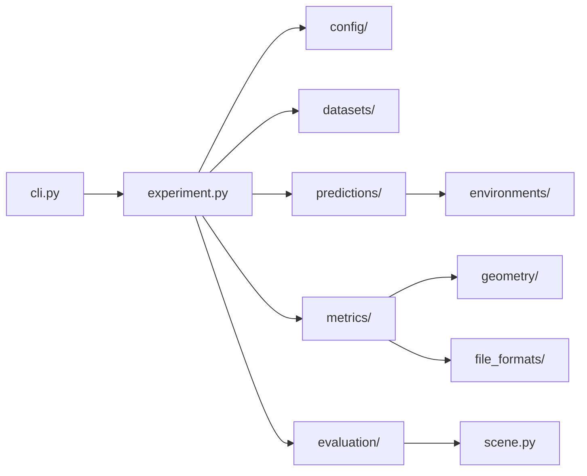

# Ядро `pano3dbench`

Здесь код, который оценивает модели. Одна команда `pano3dbench run` проходит цепочку
«загрузить примеры → получить предсказания → посчитать показатели → сохранить отчёт».
Каждая папка отвечает за одно звено, и по названию папки видно, какую часть цепочки ты
читаешь. Ядро работает на Python 3.9, из сторонних пакетов ему нужен только PyYAML.
Модели оно не импортирует: каждая модель работает в своём окружении
([environments/](environments/README.md)).

## С чего читать

1. [`experiment.py`](experiment.py): `run_experiment()` читает конфигурацию, создаёт
   компоненты и передаёт их `Evaluator`. Из этой функции видно, какие участники
   существуют и как они соединены.
2. [`evaluation/evaluator.py`](evaluation/evaluator.py): `Evaluator.run()` проходит сцены,
   вызывает показатели и сохраняет результат.
3. Остальное открывай по мере надобности, по таблице ниже.

## Файлы и папки

| Путь                                      | За что отвечает                                                                                      |
|-------------------------------------------|------------------------------------------------------------------------------------------------------|
| `cli.py`                                  | разбирает аргументы `pano3dbench run` и `pano3dbench env ...` и вызывает действие                    |
| `__main__.py`                             | позволяет запускать ядро как `python -m pano3dbench`                                                 |
| `experiment.py`                           | собирает эксперимент из конфигурации: `create_dataset`, `create_prediction_source`, `create_metrics` |
| `scene.py`                                | контракт данных: `SceneSample` (вход), `SceneOutput` (сцена), `SceneObject`, `SceneRelation`         |
| `registry.py`                             | `ComponentRegistry`: имя из YAML (`fixture`, `manifest`, `object_map`) → класс                       |
| `provenance.py`                           | ревизия git для `run.json`                                                                           |
| [`config/`](config/README.md)             | чтение и проверка конфигурации эксперимента                                                          |
| [`datasets/`](datasets/README.md)         | откуда берутся примеры и эталонные сцены                                                             |
| [`predictions/`](predictions/README.md)   | откуда берутся предсказания: готовые JSON или внешний раннер                                         |
| [`evaluation/`](evaluation/README.md)     | ход оценки, сводная статистика, запись результатов                                                   |
| [`metrics/`](metrics/README.md)           | правила показателей: макет, обнаружение, физика, форма                                               |
| [`geometry/`](geometry/README.md)         | математика без знания об экспериментах: рамки, многоугольники, облака точек                          |
| [`file_formats/`](file_formats/README.md) | чтение сеток PLY/OBJ и облаков точек JSON/F32                                                        |
| [`environments/`](environments/README.md) | сборка и поиск изолированных окружений моделей                                                       |

## Как расширять

Новая реализация — это класс, унаследованный от базового, с декоратором реестра. Реестр
лежит рядом с базовым классом:

| Что добавить          | База                                   | Реестр                 |
|-----------------------|----------------------------------------|------------------------|
| загрузчик набора      | `datasets.base.DatasetLoader`          | `DATASET_LOADERS`      |
| источник предсказаний | `predictions.base.PredictionSource`    | `PREDICTION_SOURCES`   |
| показатель            | `metrics.base.Metric`                  | `METRICS`              |
| бэкенд окружения      | `environments.base.EnvironmentManager` | `ENVIRONMENT_MANAGERS` |

Параметры из конфигурации передаются в конструктор как именованные аргументы, поэтому
сигнатура `__init__` и есть список параметров компонента. Исключение пока одно:
показатели получают словарь `parameters`. Подробности по устройству и запуску —
[docs/architecture.md](../../docs/architecture.md).
